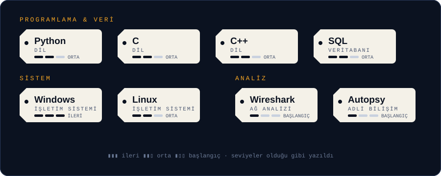

  

 

## Hakkımda

Dijital dünyada her işlem bir iz bırakır: bir log satırı, bir ağ paketi, bir dosya zaman damgası. Adli bilişim mühendisliği okurken bu izleri okumayı, birbirine bağlamayı ve anlamlı bir hikâyeye çevirmeyi öğreniyorum. Siber güvenlik tarafı ise o hikâyenin bir daha yazılmasını engellemek isteyen yanım.

## Araç Çantası

Her etiket bir araç ve onunla şu anki seviyem. Düzgün bir delil gibi, olduğu gibi kayda geçirdim.

## Olay Günlüğü

**Staj:** Petek Yazılım (stajyer)
Infinitum It (stajyer)

## Sertifikalar

<table>
<tr>
<td valign="top" width="50%">

**Siber güvenlik**
- Siber Güvenliğe Giriş · *BTK*
- Siber Güvenlik 101 · *Siber Kulüpler Birliği*
- Siber Tehdit İstihbaratı: İleri Yaklaşımlar ve Uygulamalar · *Siber Kulüpler Birliği*

</td>
<td valign="top" width="50%">

**Dijital okuryazarlık** · *Turkcell Geleceği Yazanlar*
- Word
- Sosyal Medya Kullanımı
- Mobil Uygulama Kullanımı
- Temel Bilgisayar ve İnternet Kullanımı

</td>
</tr>
</table>

## Hedefim

Adli bilişim ve siber tehdit istihbaratında derinleşmek; olay sonrası analizden savunmaya uzanan bir hat kurabilen bir mühendis olmak.

Bu dosya ben öğrendikçe güncellenir.

